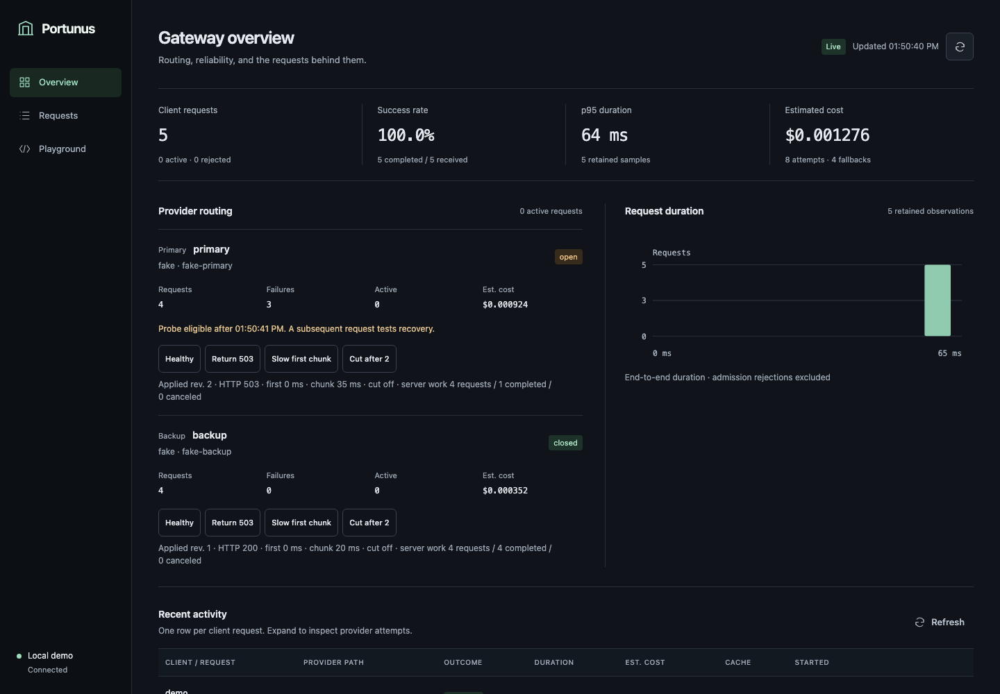

# Portunus

A fault-tolerant LLM gateway built to study the engineering behind reliable model access. Applications send one chat format. Portunus selects a provider, bounds retries and spending, streams the answer, and records what happened to every request and upstream attempt.

The local demo includes two fake HTTP providers and a React + TypeScript dashboard. It needs no model credentials and makes no paid API calls.



## Start the app

Install Go 1.22 or later:

```sh
go run ./cmd/portunus
```

Open [localhost:8080](http://localhost:8080). The gateway listens on port 8080, the primary fake on 8081, and the backup on 8082. All listeners bind to loopback. Ctrl-C shuts down all three servers and cancels in-flight requests.

The frontend's compiled assets are checked in and embedded in Go. Running the app does not require Node. Rebuilding the dashboard requires Node 22.12 or later and npm.

Send a streamed request:

```sh
curl --no-buffer http://127.0.0.1:8080/v1/chat \
	-H 'Authorization: Bearer demo-key' \
	-H 'Content-Type: application/json' \
	-d '{"messages":[{"role":"user","content":"Explain provider fallback."}],"stream":true}'
```

The fake returns deterministic text, not a generated answer to the prompt. You should see `delta` events followed by `done`. Only `done` establishes successful completion. EOF without `done` is an interrupted answer, even when HTTP status is 200.

Omit `stream` for one complete JSON response. Optional fields include logical `model`, `max_output_tokens`, `temperature`, and explicit `cache` opt-in. Read [the API contract](docs/api-contract.md) for limits and metadata.

## Demonstrate failure handling

Use the dashboard to send requests and change fake-provider behavior. Set the primary to return 503 and inspect the backup attempt in the request record. Repeated failures open the primary circuit. Restore the primary, wait for the cooldown, and send another request to exercise the recovery probe.

The controls also simulate a slow first chunk and a connection cut after two chunks. A slow provider can trigger fallback before output starts. A cut after output starts interrupts the answer; Portunus never appends a second provider's answer to it.

Run the repeatable end-to-end scenarios independently:

```sh
make demo
```

The verifier starts its own isolated local instance and checks real HTTP outcomes. It does not rely on the dashboard's appearance to infer success.

## What the gateway does

- Routes logical models through ordered provider targets with one finite attempt allowance and one total deadline.
- Retries transient failures with bounded backoff, honors provider retry delays, and falls back before downstream response commitment.
- Opens circuits after repeated provider failures and permits one half-open recovery probe.
- Propagates client cancellation and bounds response parsing, output, concurrency, and downstream writes.
- Caches eligible complete responses with an exact, client-scoped key, bounded LRU storage, and TTL.
- Applies configured client keys, token-bucket rate limits, and atomic spending reservations before upstream work.
- Records client outcomes separately from provider attempts, including latency, time to first output, usage certainty, and estimated cost.
- Supports a fake protocol and a configurable OpenAI-compatible streaming protocol behind the same provider-session interface.

## Architecture and tradeoffs

One Go process hosts the gateway and two independent fake HTTP listeners. The dashboard is a static React application served by Go. Requests still cross real HTTP connections, so tests exercise flushing, disconnects, statuses, and truncated bodies.

The gateway owns one attempt loop. Provider adapters only open, read, normalize, and close a single generation session. They never retry. This makes response commitment and reservation settlement visible in one place rather than spreading them across middleware.

Policy state, cache state, and telemetry are bounded and synchronized inside one gateway instance. Network I/O and backoff happen outside the state lock. This favors an implementation a student can trace over a distributed deployment with Redis or a database.

Read [the architecture notes](docs/architecture.md) for the request lifecycle, retry boundary, circuit leases, budget accounting, cache identity, and limitations. [The build plan](docs/build-plan.md) and [decision trail](docs/decisions.tsv) record the implementation choices and their verification evidence.

## Configuration

The default demo key is `demo-key`. A separate `limited-key` client demonstrates policy rejection. These are local demonstration credentials, not user accounts or real provider keys.

```sh
go run ./cmd/portunus -config configs/demo.json
```

Configuration includes provider targets and prices, route aliases, client keys or key environment-variable names, traffic limits, cache bounds, and circuit settings. Duration fields in JSON are numeric nanoseconds. CLI duration flags use values such as `300ms` and `30s`.

For an optional real service, copy [the compatible-provider example](configs/openaicompat.json), choose a supported model, set the referenced environment variables locally, and update the configured prices. The example's prices are illustrative. Never commit credentials.

The adapter targets the text-only Chat Completions SSE subset with `max_tokens`, streamed usage, and a terminal `[DONE]`. Compatibility with any specific model or vendor requires that provider to support this subset. Protocol fixture tests do not establish live-service compatibility, and no paid-service run is included in the local benchmark results.

## Verify and rebuild

```sh
make verify
```

This installs locked frontend dependencies, type-checks React, tests the browser client's stream parser against real HTTP, rebuilds the frontend, checks Go formatting, runs `go vet`, and runs Go tests with the race detector. The CI workflow also checks that committed frontend assets match the build and runs the scenario verifier.

For Go-only verification:

```sh
make verify-go
```

To rebuild the frontend:

```sh
make web
```

## Benchmarks

```sh
make benchmark
```

The benchmark uses real local HTTP requests, checks terminal completion and answer content, compares direct-provider and gateway paths, measures time to first output, and tests outage completion and cache reuse. It retains raw observations, failure counts, and actual provider work counts. Direct and gateway baseline calls use the same streaming workload.

The [recorded results and methodology](docs/benchmarks/README.md) include five rounds at eight concurrent workers. All 500 measured outage requests completed, and 500 warm cache requests performed zero upstream calls. The observed paired median first-text difference was 0.354 ms, with round differences from 0.205 to 0.408 ms. Total-latency differences crossed zero, so this run does not establish a stable isolated total overhead.

`make benchmark` also regenerates the Markdown summary using Node. For raw Go-only measurement, run `go run ./cmd/portunus-bench -output results.json`.

Synthetic token counts and configured cost estimates are not real provider bills. Local loopback measurements do not establish Internet-provider latency, production capacity, or availability guarantees. The [diagnostic notes](docs/benchmarks/diagnostics.md) retain the profiling evidence and its limits.

## Known limitations

This is a single-instance portfolio system. State resets on restart, budgets and circuits are not shared across replicas, and the demo's three listeners share one process. Simulated HTTP faults do not demonstrate independent process or host failure.

Fallback models can produce different answers. A timeout does not prove that an upstream provider stopped generating or charging. Spending controls reserve conservative estimates and settle reported usage; they are not billing guarantees against a provider that reports unexpected usage or prices.

The supported request format is text-only. Tools, images, semantic caching, durable audit storage, accounts, and billing are outside scope.
