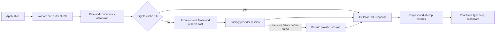

# Request ownership and failure boundaries

Portunus uses one gateway instance, two local fake HTTP providers, and an embedded React dashboard. The application is intended to make concurrency and failure behavior inspectable. It does not attempt a multi-replica control plane or durable billing system.

## Request flow

The public request format has messages, a logical model alias, an output cap, temperature, a streaming flag, and explicit cache opt-in. The HTTP boundary validates external input and resolves the caller to a configured client. A client is a traffic-policy identity, not a user account.

## One owner for provider attempts

`internal/gateway` owns the engine, attempt loop, policy state, cache, and records. These responsibilities share a synchronized state model. The implementation keeps them close so a request's reservation, circuit lease, and outcome can be traced without middleware nesting.

`internal/provider` owns a pull-based session interface. Opening a session establishes one upstream HTTP request. Reading it returns normalized text, usage, and completion events. Closing it releases the response body and upstream work. Adapters never retry.

Stage one used a transparent reverse proxy. That was sufficient when the fake and public APIs shared a wire contract. Supporting a distinct OpenAI-compatible protocol now justifies normalization. The adapter owns re-encoding, parser bounds, provider credentials, and terminal-event rules. The public request limit remains independent from bounded internal provider payloads, so JSON escaping cannot turn a valid public prompt into a spurious provider size rejection.

## Response commitment determines whether fallback is possible

Connecting upstream, receiving headers, or receiving usage metadata does not commit a client response. The engine can still discard an unsuccessful attempt and select another provider.

For a streaming client, the first public write commits the response. From that point, the engine can report an interrupted stream but cannot retry or change providers transparently. A different model could otherwise append an unrelated answer to text the caller already received.

JSON clients receive one bounded complete response. Their response remains uncommitted while the engine reads the upstream session.

The public SSE protocol uses `delta`, `done`, and `error` events. Only `done` means successful completion. An error event or EOF without `done` means failure, even after HTTP 200. Client code must consume the stream through its terminal event.

## Completion and usage are separate facts

A provider's text finish marker can precede its final usage report. The OpenAI-compatible adapter reads through the terminal `[DONE]` and retains usage arriving after a finish reason. EOF without protocol completion is an error.

Usage includes an explicit certainty flag. The fake reports authoritative usage for its synthetic UTF-8 byte-unit model. That is deterministic test accounting, not a claim about a real tokenizer. An external response without authoritative usage cannot support precise cost settlement or cache eligibility.

The supported remote protocol is text-only streamed Chat Completions. Tools and multimodal content are outside this interface. Fixture tests verify the supported protocol behavior without establishing compatibility with every provider or model.

## Deadlines, retries, and circuits

One total deadline and one finite attempt allowance cover the request. Provider adapters do not create additional retry loops. The first-content timeout covers connection setup, response headers, and waiting for meaningful text. It stops after the first text event while the total deadline continues.

Transient provider errors can select another eligible target or permit bounded retry. Backoff observes cancellation. Provider retry delays prevent immediate reuse of a throttled target. Permanent input or authorization errors do not become a retry storm.

Circuits have closed, open, and half-open states. Repeated provider failures open the circuit. After the cooldown, one request obtains the recovery probe. Generation-tagged leases prevent an older concurrent attempt from changing a newer circuit state. Every exit path releases active capacity and settles its lease.

No state lock is held during HTTP calls, response writes, or backoff. A single mutex makes the in-memory admission and settlement invariants explicit; throughput measurements must establish whether it becomes a limiter before replacing it with more complex synchronization.

## Spending reservations and uncertainty

Money uses integer micro-US dollars. Prices are configured as micro-US dollars per million input or output tokens, with overflow checks and upward rounding. Prices in the demo configuration are illustrative.

Before dispatching an attempt, the engine reserves a conservative maximum using input byte bounds, message overhead, and the requested output cap. Concurrent requests share one atomic ledger, so they cannot independently spend the same remaining capacity. Provider capacity and circuit eligibility are checked as part of attempt acquisition.

Authoritative usage settles the attempt's configured cost. An uncertain failed execution retains a conservative charge because cancellation or a timeout does not prove that a provider stopped generating or billing. Proven unstarted work can release its reservation. The local fake's HTTP 429 is known to reject before generation; arbitrary compatible-provider 429 responses remain uncertain and retain a conservative charge.

Request-level usage sums known counts and remains uncertain if any possibly executed attempt has unknown usage. A successful backup does not erase uncertainty from the primary attempt. Permanent request errors appear in failure telemetry but do not open the shared provider circuit. Free cache hits remain available after the spending budget is exhausted, provided rate admission permits them.

Actual provider-reported usage can exceed an estimate. The ledger records that reported cost and rejects future work when capacity is exhausted. This is a local admission policy, not a promise that an external provider's bill can never exceed the configured budget. Changed prices, tokenization, unexpected usage, restarts, and other callers of the provider account remain outside that guarantee.

## Exact caching

Caching is explicit and restricted to eligible deterministic settings. Keys include client identity, normalized messages, logical model, generation settings, routing targets, and configuration revision. Stream framing is not generation identity, so a complete eligible answer can be replayed as JSON or SSE.

Only bounded, successfully completed responses with authoritative usage are stored. Incomplete responses, errors, uncertain usage, and unsafe fallback identities are not cached. TTL, LRU entry count, and byte bounds constrain memory. A cache hit remains a client request but performs no upstream attempt and incurs no provider charge.

## Observability and the operator surface

Every client request has a record. Each actual upstream attempt has its own nested record. A request that succeeds through fallback can therefore retain the failed primary attempt instead of hiding it behind a successful final status.

Records include duration, time to first normalized text, cache outcome, usage certainty, reservation, and cost. They exclude prompts, generated content, client keys, and provider secrets. Counters cover the process lifetime; percentile samples cover the bounded retained request window. Empty samples are unavailable, not zero latency.

The dashboard polls the versioned snapshot and request APIs. Its playground calls the normal chat endpoint. Fault controls update only local fake-provider configuration; they do not manufacture request records or reset circuits into success. Operator mutations require a same-origin request on the loopback operator surface.

## Verification and measurements

Real HTTP tests establish flushing, cancellation, malformed-provider behavior, completion, and response-commitment boundaries. Concurrent policy tests establish reservations, capacity release, and half-open probe exclusivity. The end-to-end verifier starts a compiled executable and drives the same public interfaces used by the dashboard.

The benchmark consumes complete responses and verifies answer content. Direct and gateway baseline paths use equivalent streaming work. Separate cache and outage phases inspect actual provider counters. Raw observations, failure counts, workload settings, and limitations belong with any reported number.

Local fake-provider measurements do not establish real-provider cost savings or production capacity. A measured local percentile is useful only with its workload, run-to-run spread, and evidence that the intended work happened.

## Known boundaries

All state resets on restart and belongs to one instance. The two fake listeners share the gateway's process. The operator UI is local, with no accounts or durable audit database. Cache entries do not make stochastic models reproducible, and fallback targets can differ in capabilities and answer quality.
